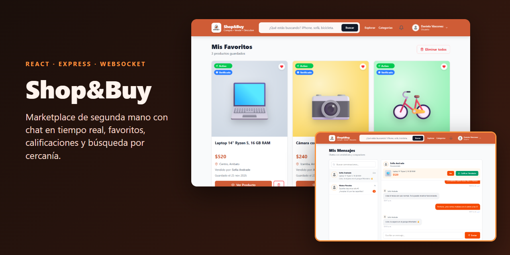
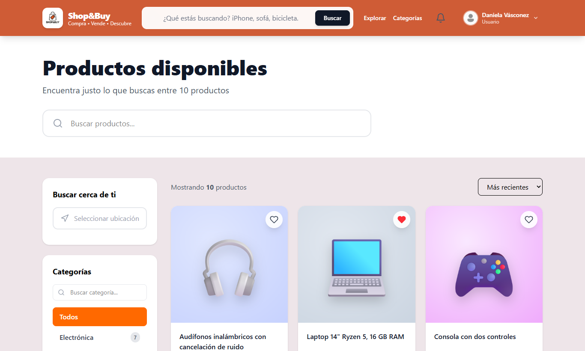
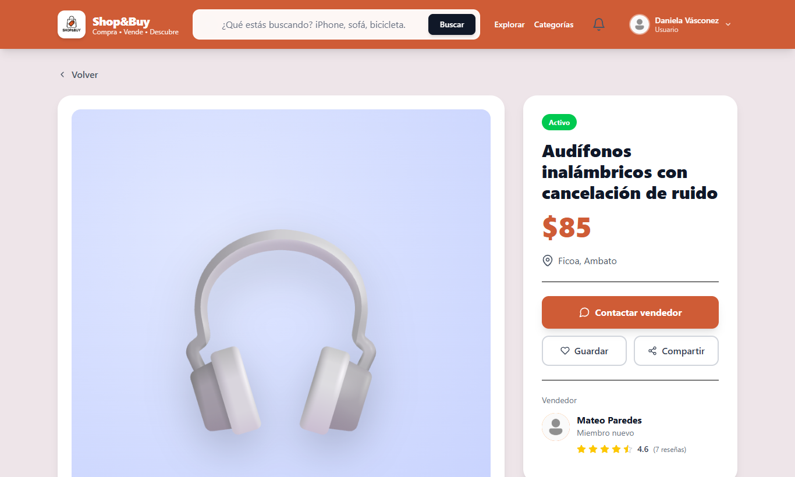
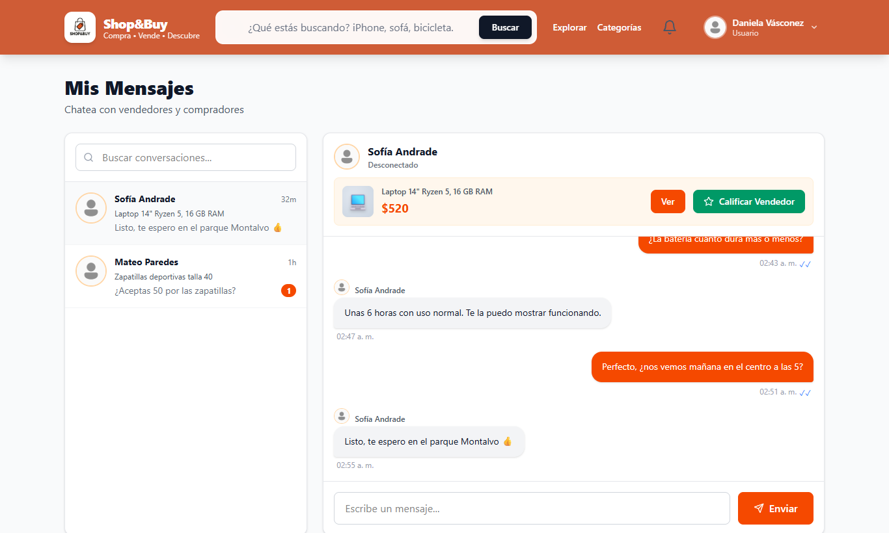
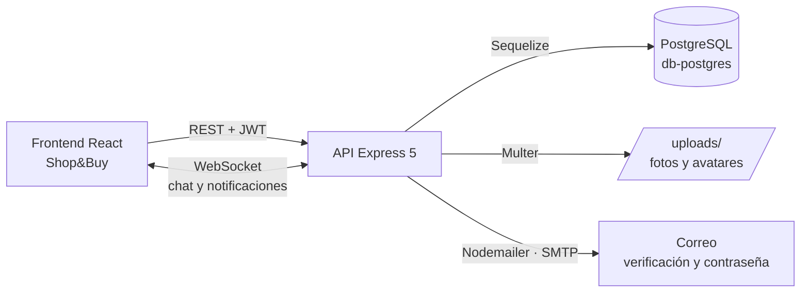

# Shop&Buy · Backend del marketplace (Web y Móviles)

API REST de un **marketplace** de compra y venta entre usuarios: productos con fotos, categorías y
subcategorías, favoritos, calificaciones, chat entre comprador y vendedor en tiempo real, notificaciones y
cuentas con verificación por correo. Proyecto de la asignatura **Aplicaciones Web y Móviles** (2025); el
frontend está en [Proyecto-Web-y-Moviles---Frontend](https://github.com/Jostero32/Proyecto-Web-y-Moviles---Frontend).

**Stack:** Node.js · Express 5 · Sequelize · PostgreSQL · JWT · Multer · Nodemailer · WebSocket (express-ws) · Swagger



| Productos | Detalle | Chat en tiempo real |
|---|---|---|
|  |  |  |

<sub>Capturas con datos de demostración inventados. La interfaz es del
[frontend del equipo](https://github.com/Jostero32/Proyecto-Web-y-Moviles---Frontend); este repositorio es la API.</sub>

## Arquitectura



## Inicio rápido

```bash
cp .env.example .env          # complete DB_PASS, JWT_SECRET y el correo
docker compose up -d --build
```

- API: <http://localhost:8080>
- Documentación Swagger: <http://localhost:8080/api-docs>

El backend se conecta a la base por el nombre del contenedor (`db-postgres`). Las credenciales se leen
de `.env`, que no se versiona.

### Correo

La verificación de cuenta y el cambio de contraseña envían correos por SMTP. Con Gmail, genere una
**contraseña de aplicación** (Cuenta de Google → Seguridad → Contraseñas de aplicaciones) y póngala en
`EMAIL_PASS`.

## API

| Recurso | Ruta base | Autenticación |
|---|---|---|
| Usuarios: registro, login, `whoami`, verificación de correo, cambio de contraseña | `/users` | Parcial |
| Categorías y subcategorías | `/categories` | Pública |
| Productos: publicar, fotos, estado, calificar | `/products` | Parcial |
| Favoritos | `/favorites` | JWT |
| Conversaciones y mensajes | `/conversations`, `/messages` | JWT |
| Notificaciones | `/notifications` | JWT |
| Roles | `/roles` | JWT |
| Archivos subidos | `/uploads` | Pública |

## Estructura

```
src/
├── routes/        Rutas por recurso
├── controllers/   Lógica de cada endpoint
├── models/        Modelos Sequelize (usuarios, productos, fotos, chat, notificaciones…)
├── middlewares/   Autenticación JWT y subida de archivos
├── sockets/       Chat y notificaciones en tiempo real (WebSocket en /)
├── utils/         JWT y envío de correos
└── config/        Base de datos y Swagger
```
